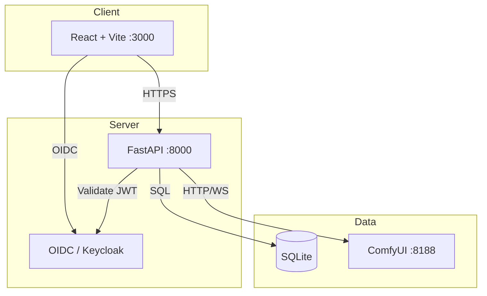

# beacon-lens

> Work in progress. This checkpoint may be incomplete or fail tests. See PLAN.md and STATUS.md before use.


> Auth-oidc complete with integration tests. linux-packaging remains planned. See PLAN.md and STATUS.md for details.


**beacon-lens** — Ryan Vo | AI & Machine Learning

An intentional crafting engine for artists, designers, and filmmakers. beacon-lens bridges local generative AI (ComfyUI) with creative workflows: project management, script-to-storyboard generation, and Linux-native packaging.

## Problem
Creative professionals using generative AI face a fragmented ecosystem: cloud-only services, no Linux support, and disconnected tools for writing, storyboarding, and generation. beacon-lens provides a unified, locally-first platform where Fountain scripts become AI storyboards via your own ComfyUI instance — all on Linux, packaged as AppImage.

## Implemented AI/ML Approach
- **Local generation adapter**: ComfyUI REST/WebSocket client with workflow submission, progress polling, and result retrieval
- **Fountain parser**: Deterministic screenplay parsing into structured scenes, characters, and camera directions
- **Storyboard engine**: Scene → prompt template → ComfyUI workflow → image sequence → storyboard export (PDF/JSON)
- **No cloud dependency**: All generation runs on user's hardware; LLM explanations are opt-in, advisory, and grounded in actual generation records

## Intended User
Independent filmmakers, storyboard artists, and technical directors who run ComfyUI locally and want a professional, Linux-native toolchain from script to animatic.

## Quick Start

### Prerequisites
- Docker 24+ and Docker Compose v2
- Node 24 (for frontend dev)
- Python 3.12 (for backend dev)
- ComfyUI running at `http://localhost:8188` (for generation features)

### Development
```bash
# Backend
cd backend
python3 -m venv .venv
. .venv/bin/activate
pip install -r requirements.txt
cp ../.env.example .env  # adjust as needed
uvicorn app.main:app --reload --host 127.0.0.1 --port 8000

# Frontend (separate terminal)
cd frontend
npm install
npm run dev  # serves at http://localhost:3000

# Or use Docker Compose (includes Keycloak)
docker compose up --build
```

### Testing
```bash
# Backend tests
cd backend
. .venv/bin/activate
PYTHONPATH=. pytest tests -v

# Frontend tests
cd frontend
npm test
```

### Production Build
```bash
docker compose -f compose.yaml -f compose.prod.yaml up --build -d
```

## API Endpoint Reference

| Method | Path | Description | Auth |
|--------|------|-------------|------|
| GET | /health | Service health check | No |
| GET | /api/v1/projects | List projects (paginated) | Yes |
| POST | /api/v1/projects | Create project | Yes |
| GET | /api/v1/projects/{id} | Get project | Yes |
| DELETE | /api/v1/projects/{id} | Delete project | Yes |

> Storyboards and generations are implemented as backend services (`StoryboardService`, `ComfyUIService`) with tests, but do not yet have API endpoints. See PLAN.md `linux-packaging` for future work.

## Architecture



## Security Limitations
- **Demo mode**: Binds to `127.0.0.1` only; refuses to start in production without explicit `DEMO_MODE=false` and valid OIDC config
- **Tokens**: Access tokens kept in memory (SPA PKCE flow); never persisted to localStorage
- **Secrets**: `LLM_API_KEY` server-side only; `.env.example` has no real credentials
- **CORS**: Restricted to configured frontend origin
- **Rate limiting**: Not yet implemented (planned)

## Provider Configuration

| Variable | Description | Default |
|----------|-------------|---------|
| `LLM_PROVIDER` | `openai-compatible` \| `anthropic` \| `gemini` \| `ollama` | `openai-compatible` |
| `LLM_MODEL` | Model identifier | `gpt-4o-mini` |
| `LLM_BASE_URL` | OpenAI-compatible base URL | `https://api.openai.com/v1` |
| `LLM_API_KEY` | **Required** for LLM features | — |
| `COMFYUI_URL` | ComfyUI API base | `http://localhost:8188` |
| `KEYCLOAK_URL` | Keycloak base URL | `http://localhost:8080` |
| `KEYCLOAK_REALM` | Realm name | `beacon-lens` |
| `KEYCLOAK_CLIENT_ID` | Client ID | `beacon-lens-frontend` |

## SSO / SAML Setup
Keycloak supports upstream SAML IdPs via Identity Brokering:
1. Import `keycloak/realm-export.json` into Keycloak
2. Configure SAML Identity Provider in Keycloak Admin Console
3. Map SAML attributes to Keycloak roles (`viewer`, `operator`, `admin`)
4. Update frontend `KEYCLOAK_IDP_HINT` for IdP-initiated login

## AI/ML Evaluation

**Reproducible command** (deterministic, offline):
```bash
cd backend && PYTHONPATH=. pytest tests/test_fountain.py tests/test_storyboard.py -v
```

**Approach**: The Fountain parser (`app/services/fountain.py`) deterministically parses screenplay text into structured scenes, characters, and dialogue. The storyboard engine (`app/services/storyboard.py`) converts scenes into generation prompts using a deterministic template. ComfyUI integration (`app/services/comfyui.py`) submits workflows and polls for results, with error handling for queue full, OOM, and timeout conditions.

**Data provenance**: All test fixtures are inline strings within the test modules; no external dataset is required.

**Determinism**: Fountain parsing and prompt generation are fully deterministic with no LLM or model dependency. Generation requires a running ComfyUI instance (local LLM inference); no API keys are needed.

**Limitations**: Actual image generation has not been measured on this hardware. ComfyUI must be running separately with a compatible checkpoint. Generation latency, VRAM usage, and success rate depend on the local hardware and model.

## License
MIT License — Copyright (c) 2026 Ryan Vo <ryandtvo@gmail.com>

See [LICENSE](LICENSE) for full text.